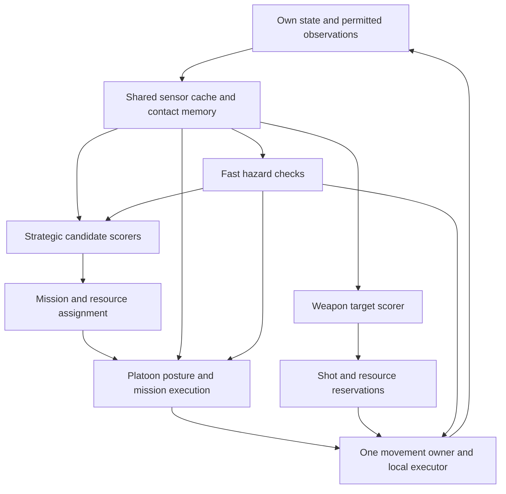

# MiniBAR sensor functions and small MLP brains

Research and design proposal, 2026-10-16. Three investigators examined BAR unit
capabilities, strategic decisions in recorded human games, and tactical decisions
in those games. This combines their findings. It adds no implementation or trained
weights. Proposed sensors and timings below are design choices, not measured gains.

The subsequent [runnable baseline package](../data/brains/from_replays/README.md)
implements a subset and records its training results and remaining gaps.

Use two learned decision levels: strategy assigns objectives and resources;
platoon tactics chooses how to execute each mission. Both consume a shared,
perspective-limited sensor cache. A fast local executor handles urgent hazards,
weapon readiness, legal actions and movement. It can wake a relevant neural module
without waiting for strategic polling.

Here, **sensor function** means the requested observable input function
("perceptron" in the discussion). Input extraction, learned neurons and action
outputs remain separate contracts. Hidden neurons acquire their meaning through
training; the named functions below define what information training can use.

## Evidence and scope

The unit investigation covered Armada, Cortex and Legion land units, aircraft,
ships, underwater/amphibious units, buildings, support and strategic weapons in
the current BAR source checkout. A read-only census parsed 666 definitions;
18 dynamic files, mainly assist drones and commander variants, were not parsed.
Scavenger and other special folders were excluded. Explicit build-option traversal
from each faction's commander found 190 Armada, 187 Cortex and 195 Legion reachable
definitions, including one Cortex mine shared by Legion. These are overlapping,
pre-postprocessing source graphs, not verified match-selectable rosters. Loaded
game options, definition postprocessing and runtime mechanics remain authoritative.

The match investigators selected the same Eclipsed duel for strategic and tactical
analysis, with Hades Ponds and Cape Violet as strategic supplements. All three
metadata records say `has_bots: false`, engine `2026.07.04`, and game
`Beyond All Reason test-31251-0ceadc7`.

| Match | Replay ID | Players |
| --- | --- | --- |
| Eclipsed 0.9.8 | `055ea46a6e410bc9d9a94fe68ea66024` | RAM_GreedyDArc versus epienriz |
| Hades Ponds 1.1 | `c742a46adc4756834973c6b6e64bccb2` | [APM]Nekuodah versus [AMADO]HH2 |
| Cape_Violet_V1 | `2237a46af92e5abc67191bea78268ea7` | RAM_Noctis versus [MADO]maratus |

Existing reviews are AI-authored audits of human matches. They are not completed
expert-human judgments of player intent. The investigators checked timestamped
examples against the raw Parquet observations and commands. The parent independently
checked Eclipsed metadata, resource values, command windows and observation fields.

Snapshots are 300 frames apart, about ten simulated seconds. Command entries retain
their own timestamps and often describe the interval **after** the row's observation.
These actions may be demonstration labels; they must not become decision-time inputs.
The data can inform mission design but cannot establish subsecond reactions or exact
per-shot micro. Ordinary unit/command records in this shard also lack stable unit
IDs; command counts and nearest-neighbor matching cannot prove squad membership.

## What the human games establish

| Episode | Raw evidence | Consequence for sensors |
| --- | --- | --- |
| Hades, Nekuodah, 1:40, frame 3000 | Three construction bots, three mexes, one lab, no combat units or disclosed enemies; following commands queue mexes, LLTs, radar and armed extractors across expansion directions. | Track expansion yield, travel, security and committed work. Distinguish ordered construction from completed capacity. |
| Hades, Nekuodah, 3:40, frame 6600 | Own roster includes 26 Fleas and three Pawns; following interval contains 31 MOVE commands for Fleas with destinations in several areas. | Commands are not distinct units. Several local missions cannot be represented by one global army centroid. |
| Eclipsed, GreedyDArc, 2:00, frame 3600 | Four live Pawns and no disclosed enemies; 37 Pawn MOVE commands occur at frames 3642–3899. | Movement alone does not establish an attack, and those future commands cannot be sensors at frame 3600. |
| Eclipsed, 4:30, frame 8100 | Energy storage 0.665, income 222.500/s, actual expense 222.436/s, requested pull 299.001/s. Low reserves and pull above income remain at 4:40 and 4:50. | Actual spending conceals resource starvation. Expose requested demand, unmet demand and persistence. |
| Eclipsed, 4:30–4:40 | Twelve live Pawns occupy seven 1000-elmo grid cells; nine remain ten seconds later. Enemy contacts occupy separate lanes. | A centroid shift is not proof of a coordinated retreat: deaths and membership changes also move centroids. Track local groups, losses and uncertainty. |
| Eclipsed, 5:50, frame 10500 | Energy 2726.6/2750 with overflow 512.4/s; metal income 24.202/s versus pull 1.865/s and reserve 1281.3/1750. | Sense overflow and available production/build power. This establishes low resource use, not its exact cause. |
| Eclipsed, 7:40, frame 13800 | Fifteen live Pawns across five spatial cells; seventeen live enemy contacts, eight LOS and nine radar-only. Mex, movement and recovery commands coexist. | Preserve simultaneous missions and separate contact knowledge from force strength. Unknown radar HP is not zero HP. |
| Eclipsed, 9:00, frame 16200 | Twenty-seven Pawns plus two Flash; the audit's alleged 84-unit group comes from movement-command counts. | Build capability totals from actual members; keep activity intensity separate. |
| Eclipsed, 10:37.23, frame 19117 | A constructor orders an aircraft plant; an owned plant is first listed at 10:50. | New production domain, tech tier, investment intent and completion are different state variables. |
| Cape Violet, 1:40–1:50 | No disclosed enemies at frame 3000; subsequent commands queue geothermal power, AA and radar, then send a scout toward the far side. | Scouting and precautionary defense matter. This does not establish a reaction to observed aircraft. |

The old audits contain mistakes about army composition, command counts and event
timing. Their label names and thresholds are not policy truth. In particular,
withdrawal, reinforcing an asset, staging, and attacking must remain distinguishable.

## Unit capabilities and overlapping roles

Each unit has one physical chassis and one movement owner, with a vector of
capabilities and one or more weapon/firing groups. A unit can contribute to several
capability totals without belonging to several competing movement controllers.

| Source case | Established capability | Required distinction |
| --- | --- | --- |
| Armada Jaguar, `armlatnk` | Ground lightning range 300; AA missile range 600; separate script aiming signals/turret pieces. | Independent weapon opportunities, shared chassis; lightning chaining also makes output depend on target density. |
| Armada Marauder, `armmar` | Ground cannon range 350; AA missile range 600; distinct aiming routines with AA deployment state. | Separate mounts do not imply that both are immediately ready. |
| Cortex Banisher, `corban` | One missile mount, default damage 1000, range 800, reload 7.5s; `NOTSUB` targeting, with `VTOL` discouraged. | Ground and air shots compete for one salvo. A target preference is different from an eligibility restriction. |
| `armserp`, `corssub`, `leganavyheavysub` | Water weapons, sonar and stealth-related properties. | Detecting, identifying, reaching and damaging a submerged target are separate capabilities. |
| `armawac`, `corawac`, `legspradarsonarplane` | Aircraft can supply radar and sonar over other domains. | A support aircraft has strategic sensing value beyond its direct damage. |
| `armrectr`, `cornecro`, `legrezbot` | Recovery/build capabilities and radar stealth. | Reclaim/resurrection opportunity and worker exposure need their own sensors. |
| `armspy`, `corspy`, `legaspy` | Cloak costs and stealth properties. | Unknown territory and detection gaps are uncertainty, not permission to expose hidden units. |
| `armgate`, `corgate`, `legdeflector` | Shields have coverage, charge, regeneration and energy costs. | Coverage without sustainable charge is not full protection. |
| `armamd`, `corfmd`, `legabm` | Stockpiled interception and protection coverage. | Count ammunition and applicable coverage, not nominal weapon range. |
| All three factions' silos | Stockpiled strategic strike capability. | Readiness, target concentration and uncertain enemy protection differ from ordinary DPS. |
| Legion carriers, clusters and timed damage | Gadget-backed drone lifecycle, spawned submunitions and persistent damage areas. | A control/spawn weapon is not ordinary projectile DPS; account for parent dependence and persistent hazards. |

The source graphs contain sensing, stealth, transports, resurrection, shields,
interception and water weapons in all three factions. Legion's reachable graph also
contains carrier/drone, cluster and persistent-area cases that particularly stress
a direct-DPS abstraction. These examples motivate faction-independent capability
features rather than three separately hard-coded role taxonomies.

An engagement estimate should start from target eligibility and then account for
armor-adjusted damage, delivery probability, firing geometry, readiness and resource
availability. Available capacity must respect shared reload/ammunition/aiming
constraints. Report both expected damage and uncertainty; do not silently equate
uncertain threats with harmless threats or multiply confidence into damage twice.

## Sensor contracts

The registry below is a menu. **Do not feed every sensor to every network.** Some
functions return several scalars. Each brain gets a versioned, labeled subset,
including any knowledge masks, with no more than 32 inputs under the current MLP
implementation.

Each function needs a defined scope, observation source, units, reference frame,
normalization, availability/confidence, age, update trigger and cost. Store readable
raw values in traces alongside encoded inputs. Share missingness/confidence per
source family when appropriate; three metadata scalars per input would waste the
small input budget.

Suggested encoding conventions:

- Fractions use `[0,1]`; signed margins use `[-1,1]`.
- A force balance can use `(ours - theirs) / (ours + theirs + epsilon)`, with a
  presence mask distinguishing two absent forces from two equal forces.
- Positive amounts use `x / (x + reference)` or a fixed clipped scale. Freeze scale
  constants as part of the brain contract; do not silently change them at inference.
- Times and distances use an explicit tactical/strategic horizon or relevant range.
  Include a validity flag for unreachable, non-depleting or unknown cases.
- Bearings use sine/cosine or local-frame coordinates, not discontinuous raw angles.
- Own state may be exact. Enemy HP, reload, stockpile, shields and production are
  observations or estimates only; hidden authoritative values cannot be inputs.
- Predictions use current/past observations, never actual future trajectories.

`P0` means foundational for the first useful slice; `P1` means the next extension;
`P2` means a specialized follow-up. It does not mean the simulator already implements
the feature. Cadences are initial budgets to measure, not established optimal rates.

## Capability and local sensor catalog

The unit investigator proposed capability/readiness/coverage functions; the tactical
investigator added mission-conditioned exchange, grouping and threat-response
functions. This consolidates overlapping proposals without discarding their scopes.

| ID / priority / function | Scope and inputs | Output and encoding | Refresh and expected cost |
| --- | --- | --- | --- |
| C01 P0 `contact_knowledge` | Contact modality, identification, HP-known, last disclosure and motion uncertainty. | Known/unknown flags, age/horizon, confidence and positional uncertainty. | Contact events plus 2–5Hz decay; shared O(contacts). |
| C02 P0 `weapon_readiness` | Own mount reload, burst/deployment/aim state, stun, ammo and resource supply. | Ready-now, time-to-shot/horizon, affordable fraction. | Shot/state/resource events; O(own mounts), cheap. |
| C03 P0 `engagement_solution` | Mount-target eligibility, armor, range, arc, LOS and delivery estimate. | Legal mask, expected damage/horizon and time-to-reach firing position. | 5–10Hz for bounded candidates; cache geometry checks. |
| C04 P0 `capacity_conflict` | Proposed assignments and shared firing/ammunition/aim/resource groups. | Free capacity fraction and competing-shot opportunity cost. | Assignment/fire changes; O(shortlisted mounts and candidates). |
| C05 P0 `directional_domain_pressure` | Incoming and outgoing applicable damage by air/surface/submerged target classes. | Separate damage/horizon and matchup margins; presence/confidence. | 2–5Hz plus contact events; local shared aggregates. |
| C06 P0 `incoming_damage` | Own damage history, visible projectiles, observed enemy shots and estimated fire. | Recent loss rate and predicted HP fraction lost over short horizons. | Damage/projectile events plus 5–10Hz; local candidate projection. |
| C07 P0 `unanswered_threat` | Incoming applicable damage versus feasible retaliation/cover. | Unanswered-damage fraction, imminent-hit time and attribution confidence. | Cheap check each tick using cached state; immediate event wake. |
| C08 P0 `survival_and_escape` | HP/shield, incoming exposure, candidate safe route and escape time. | Death urgency, escape slack, route-valid flag and safe direction. | Damage/route events plus 5–10Hz for engaged groups; route cache required. |
| C09 P1 `range_and_closure` | Relevant mount range, relative velocity, acceleration/turning and aiming delay. | Range margin, time until either side can hit, chase/escape margin. | 5–10Hz on active shortlist; cheap local geometry. |
| C10 P1 `shot_saturation` | Candidate target HP/shield knowledge and own assigned/in-flight damage by impact time. | Residual HP fraction, predicted overkill and reservation confidence. | Fire/impact/death/target-loss events; indexed target reservations. |
| C11 P1 `formation_hazard` | Member spacing, AoE/chains/clusters, persistent damage, explosive assets and blockers. | Crowding/collateral risk, firing-lane blockage, safe displacement. | Hazard events plus 2–5Hz; local grid, not all-pairs scans. |
| C12 P1 `support_coverage` | AA/anti-sub/repair/shield coverage and threatened member separation. | Applicable protection fraction, support ETA and role-specific deficit. | 2–5Hz and support loss; shared spatial coverage fields. |
| C13 P1 `sensor_coverage_gap` | Own LOS/radar/sonar/jamming coverage, visited regions and stale routes. | Unseen fraction, modality gap and age; no hidden-unit count. | Sensor events plus 0.5–1Hz; shared grids. |
| C14 P1 `concealment_risk` | Lost contacts, plausible stealth/cloak evidence and detection gaps. | Risk/uncertainty components for route or asset. | Evidence events plus 0.5–1Hz; belief cache. |
| C15 P1 `protective_capacity` | Shield charge/geometry/energy and antinuke ammo/coverage against estimated saturation. | Protected fraction, reserve margin and exposed value. | Ammo/energy events plus 1–2Hz; spatial joins. |
| C16 P2 `carrier_capacity` | Parent state, active/reserve/docked drones, control radius, spawn resources and launch time. | Available capability, launch ETA and parent-loss exposure. | Lifecycle events plus 1–2Hz; aggregate once per carrier. |
| C17 P2 `recovery_opportunity` | Known wrecks, damaged allies, recovery build power, access and danger. | Recoverable value/time and worker exposure. | 0.5–1Hz and wreck/task events; indexed candidates. |
| C18 P2 `strategic_strike_window` | Own stockpile, target concentration, observed protection and uncertainty. | Feasibility components, reserve cost and confidence. | Stockpile/intel events plus 0.2–0.5Hz; candidate cache. |

Legality is deterministic. A network scores legal choices; it does not learn that
a ground-only weapon cannot shoot an aircraft. Readiness is separate: an eligible
but reloading weapon can matter to a two-second forecast while contributing no
immediate shot. For a dual-purpose mount, separately reported air/ground potential
must not be added as simultaneous full capacity.

## Strategic sensor catalog

These functions come from the strategic investigator's raw-match review, joined
with capability-based production and asset protection from the unit investigation.
Enemy-dependent functions always use disclosed contacts and explicit estimates.

| ID / priority / function | Inputs and outputs | Refresh and expected cost |
| --- | --- | --- |
| S01 P0 `resource_buffer` | Stored/capacity per resource -> fill and bounded available amount. | 1Hz; O(1). |
| S02 P0 `resource_pressure` | Income, requested pull, actual expense -> requested net flow and unmet fraction `max(pull-expense,0)/max(pull,epsilon)`. | 1Hz and supply shocks; O(1). |
| S03 P0 `depletion_horizon` | Stored divided by positive pull-minus-income -> exhaustion time/horizon plus non-depleting flag. Assumes demand persists. | 1Hz; O(1). |
| S04 P0 `stall_persistence` | Requested/supplied allocations and progress history -> stalled work fraction and duration. | 1Hz; incremental active-project statistics. |
| S05 P0 `overflow_waste` | Overflow counters -> wasted resource/s and fraction of income. | 0.5–1Hz; counter deltas. |
| S06 P0 `production_utilization` | Operational state, queue and progress -> productive, idle, starved and exit-blocked fractions. | 0.5–1Hz and state changes; O(factories). |
| S07 P0 `builder_availability` | Task/build power/position -> free work capacity, committed work and travel ETA. | Task changes plus 0.2–0.5Hz; shared builder pass and cached paths. |
| S08 P0 `expansion_payoff` | Yield, cost, construction time and builder travel -> income gain, cost and payback horizon. | 0.2Hz; bounded sites and cached navigation. |
| S09 P0 `expansion_security` | Disclosed threats, route, builder ETA and cover -> exposure, support ETA and uncertainty. | Threat changes plus 0.2–1Hz; local/path queries. |
| S10 P0 `site_commitment` | Orders, projects and assigned builders -> committed yield, progress and completion estimate. | Events; indexed site state. |
| S11 P0 `asset_value_at_risk` | Commander, factories, income, generators, strategic protection and key projects -> replacement cost, income loss and capability criticality separately. | Asset changes plus 0.2–0.5Hz; shared pass. |
| S12 P0 `threat_arrival` | Observed enemy motion/capability and paths toward an asset -> earliest plausible damage time and confidence. | Contact changes plus 0.5–2Hz; bounded route candidates. |
| S13 P0 `reinforcement_margin` | Compatible responders, travel/setup ETA and existing commitments -> arrival slack and effective capacity at deadline. | Threat/assignment changes plus 0.5–2Hz; platoon summaries. |
| S14 P0 `available_reserve` | Ready force, current missions and diversion costs -> uncommitted capacity by capability/region. | Assignment changes plus 0.5–1Hz; O(platoons). |
| S15 P0 `coverage_deficit` | Domain-specific danger, applicable defenders and assets -> uncovered value, support ETA and uncertainty. | Urgent event plus 1Hz; uses C05/C12/C15 caches. |
| S16 P1 `objective_progress` | Standing mission state and disclosed target state -> progress, elapsed time, completion/stall/invalid masks. | Events plus 0.5–1Hz; O(active missions). |
| S17 P1 `objective_opportunity` | Known asset importance, route, defenses and force package -> income/capability damage potential, ETA and expected cost. | Intelligence changes plus 0.2–0.5Hz; bounded candidates. |
| S18 P1 `sector_control` | Reachable own force, disclosed threats, lanes and known ownership -> coverage, contention and uncertainty. | 0.2–0.5Hz; shared spatial bins. |
| S19 P1 `intelligence_age` | Last valid observation by region/domain -> staleness, coverage and confidence. | Contact events plus 0.2–0.5Hz; shared sector state. |
| S20 P1 `scouting_value` | Uncertainty that affects a current decision, scout cost/risk/ETA -> information-priority components. | Mission/intel changes plus 0.2Hz; candidate scoring. |
| S21 P1 `production_role_gap` | Required versus ready/queued capability, delivery ETA and legal build options -> marginal capability deficit. | Queue/threat changes plus 0.2–0.5Hz; factory-role candidates. |
| S22 P1 `tech_readiness` | Prerequisites, construction capacity, current projects and resource forecast -> legal mask, missing prerequisites and completion horizon. | Project events plus 0.2Hz; legal upgrade candidates. |
| S23 P1 `domain_access` | Build options, movement classes and terrain -> reachable flag, path ETA and unlocked production domain. | Map/tech events; cached. |
| S24 P2 `reclaim_return` | Known wreck resources, safe access and reclaim capacity -> resource gain, time and exposure. | Wreck/task events plus 0.2–0.5Hz; spatial candidates. |

Resource investments must account for streamed construction demand, not assume
the whole nominal price is paid at order time. Separate actual allocated spending,
desired demand, and the marginal demand of a proposed project.

## Platoon mission and coordination sensors

These add collective information that an individual unit's neighborhood cannot
reliably reconstruct. They reference the capability and strategic sensors above.

| ID / priority / function | Inputs and outputs | Refresh and expected cost |
| --- | --- | --- |
| T01 P0 `mission_context` | Mission kind, asset/region, priority, deadline, allowed losses and required capabilities -> compact flags/urgency and remaining budget. | Mission events plus 2Hz; O(1). |
| T02 P0 `local_exchange` | C02–C06 for actual local participants and near-term reinforcements -> outgoing/incoming damage balance, absolute danger, presence and confidence. | Contact/roster changes plus 2–5Hz; one shared local scan. |
| T03 P0 `asset_interception` | Enemy damage ETA versus own legal intercept arrival/setup -> deadline slack, reachable flag and protection deficit. | Threat events plus 2–5Hz; cached paths. |
| T04 P0 `escape_feasibility` | Candidate routes, expected route damage and compatible support/cover ETA -> reachable safe option, exposure and escape time. | Threat/path changes plus 1–2Hz; bounded route shortlist. |
| T05 P1 `cohesion_and_arrival` | Actual members, travel-time distribution, engaged fraction and reinforcement ETA -> straggler fraction, arrival spread and support-soon fraction. | Membership/path changes plus 1–2Hz; shared aggregate. |
| T06 P1 `mission_tradeoff` | Objective kill/protection time, exposure, allowed loss budget and alternative missions -> completion-before-deadline, expected losses and diversion cost. | Mission/contact changes plus 1–2Hz; candidate estimates. |
| T07 P1 `escort_integrity` | Protected member/group, coverage fields, separation and threat direction -> escort gap and rendezvous ETA. | 2–5Hz; C12 shared field queries. |
| T08 P2 `maneuver_options` | Small legal route/position shortlist, cover, firing arcs and separation -> relative utility features. | Route changes plus 1–2Hz; bounded geometry/path work. |
| T09 P1 `commitment_history` | Current posture age, switch count, target validity, progress and accumulated losses -> persistence/progress and remaining loss budget. | Decision events plus 2–5Hz; O(1). |

The combined registry has 51 function families. A family may produce multiple
scalars, so this is not a proposal for a 51-input network or 51 separate networks.
For example, the same `reinforcement_margin` function can be evaluated for several
candidate assets, using one shared set of MLP weights.

## Small brains and decision ownership

A monolithic network would couple unrelated decisions and require much more
whole-game training data. A purely per-unit council has trouble expressing shared
commitment, mission assignments and capacity reservations. The recommended design
keeps strategic and platoon decisions learned while using explicit candidate
generation, assignment constraints and execution.

| Proposed brain | Selected inputs | Outputs and owner |
| --- | --- | --- |
| Economic investment | S01–S10, S21–S24; select 20–28 scalars. | Scores legal power/mex/reclaim/build-capacity/storage/project candidates and urgency. Economic assignment owns spending commitments. |
| Production composition | Capability gaps, reserves, delivery ETA, resource forecasts and current queues; 20–28 scalars. | Scores `(factory, build candidate)`; allocation prevents duplicate queue commitments. |
| Strategic mission value | S11–S20 plus candidate domain access/force package; 24–28 scalars. | Scores scout/raid/assault/hold/defend/expansion-support objectives. Maintains several standing missions. |
| Force assignment | Mission requirements, responder readiness/ETA, diversion cost and reserve; 20–28 scalars. | Scores `(platoon, mission)`; deterministic constrained assignment owns membership and avoids over-allocation. |
| Platoon posture | T01–T07 plus relevant C05–C09; 20–28 scalars. | Utilities for advance/hold/skirmish/withdraw/intercept and commitment. Platoon owns coordinated movement intent. |
| Threat response | C06–C08/C12 and T01/T03/T04/T06; 12–24 scalars. | Scores seek-cover/disperse/evade/intercept/continue-mission options. Same movement owner applies the result. |
| Weapon target value | C02–C04/C09/C10 plus target mission value; 16–24 scalars per mount/candidate. | Scores legal targets. Reservation code enforces shared capacity, resource use and impact-time saturation. |
| Optional local maneuver | C08/C09/C11 and T05/T07–T09; 16–24 scalars. | Scores legal position candidates or movement preferences within the platoon contract. Add only if existing execution leaves measurable headroom. |

These are candidate responsibilities, not a requirement to build eight models
before testing anything. Start with shared capability/knowledge sensors, explicit
missions and posture/target/response decisions; add economic and strategic learned
choices once their observation and simulation contracts are trustworthy. Existing
local modules can remain while the collective layer is evaluated.

One hidden layer of 8–16 units is a reasonable initial experiment, not an established
optimum. Example shapes fitting the existing implementation are `24 -> 16 -> 1`
for a candidate scorer (417 parameters) and `24 -> 16 -> 5` for posture (485).
The current implementation uses tanh outputs, so utilities lie in `[-1,1]`;
action masking and stable selection belong outside the MLP. Input masks count
toward the 32-wide maximum too.

A mission contract should contain kind, target asset/region, required capabilities,
priority, deadline, allowed losses, reserve constraints and completion/abort rules.
Tactics reports progress, expected exposure, missing capabilities and ETA. Strategy
can then change allocations without micromanaging each unit's position.

## Rapid reactions and strategic assets

"In-band" and "out-of-band" should be derived from the actual damage/retaliation
relationship. A ground attacker can be effectively unanswered if it outranges the
platoon; an air attacker is answerable if the platoon has ready, effective AA.
Physical domain alone is insufficient.

1. Detect contact/damage/projectile changes and invalid targets using cheap checks
   each simulation tick. Wake the applicable response module for imminent hazards.
   Unattributed damage must preserve unknown source/type rather than reveal an enemy.
2. Evaluate incoming applicable damage, feasible retaliation, cover/support arrival
   and mission urgency. Keep separate signals for danger and uncertainty.
3. Select a legal immediate response: seek AA cover, evade an attack run, spread
   against splash, intercept a threat, withdraw by a viable route, or continue an
   explicitly permitted sacrifice. No-retaliation is not an unconditional flee order.
4. Send strategy a threat report with location, evidence/confidence, exposed value,
   missing capability and time-to-loss. Strategy can redirect/produce support,
   change reinforcement routes or abandon a mission that cannot be supported in time.
5. Maintain one movement owner, release expired shot reservations, and resume or
   revise the standing mission after the hazard clears. Ordinary posture switching
   uses persistence/hysteresis; urgent hazards and invalid actions bypass it.

Initial scheduling experiments: hazard checks every 30Hz simulation tick; active
local execution about 5–10Hz; platoon decisions 2–5Hz; strategic decisions 0.2–1Hz,
with events waking relevant decisions sooner. The source already provides tick and
cadence machinery, but no measured end-to-end reaction bound for this design exists.
Measure detection, feature refresh, inference, arbitration, command application and
the unit's actual response under load. A fast inference call alone proves little.

Protecting an asset means controlling approaches and damage arrival, not staying
close to it. Existing MiniBAR experiments found that a short defender leash pulled
combat and splash onto the protected target and reduced wins. Use intercept slack
and compatible fire coverage instead. Conversely, assaulting an asset should allow
a force to bypass incidental enemies when expected objective value warrants the
losses; ordinary exchange optimization alone cannot express that choice.

Jaguar/Marauder can be evaluated for ground and AA fire while their hull continues
one mission, subject to their actual readiness/script constraints. Banisher evaluates
both target types but reserves its one shot once. A target's in-flight damage
reservations should be revised on firing, miss, death, interception, lost knowledge
or reassignment, with uncertainty preventing brittle overkill accounting.

## Current MiniBAR integration limits

| Verified source condition | Implication |
| --- | --- |
| `scripts/make_catalog.py` scans six non-recursive Armada/Cortex ground folders and drops AA-only mounts. | It cannot supply the all-faction/air/naval/hybrid capability dataset. Use runtime-resolved definitions with game/options provenance for actual experiments. |
| `tactical.rs` sums paper DPS over weapons and compares whole-side power. | Ground damage can incorrectly offset air danger; distant unrelated groups can distort engagement decisions. Replace that abstraction for mixed-domain evaluation. |
| Existing target candidates are the three nearest enemies. | Mission assets, dangerous support and suitable targets can be omitted. Candidate generation should include legal mission/threat targets, not just proximity. |
| `UnitState` has per-mount state, but range/reload helpers use the first weapon. | A first-mount summary loses hybrid readiness. |
| `Command` has one target; `engine.rs` chooses it before looping weapon mounts. | Per-mount sensors do not yet permit independent AA/ground target acquisition. An explicit execution contract is needed. |
| Tactical `WorldView` exposes raw world units; strategic observation defaults to omniscient. | Learned comparisons to human play need an explicit perspective adapter and filtered observation mode. |
| Strategic observations lack requested pull, overflow, task/queue/progress telemetry, contact age and mission state. `pool_observation` currently sets expense to zero. | Strategic brains need a real telemetry contract; even the existing expense field cannot yet be relied on as measured spending. Underlying resource allocations retain requested/supplied amounts. |
| Every MLP layer is at most 32 wide, including inputs. | Small per-candidate input subsets and shared aggregates fit; a large raw-state input does not. |
| Sonar/cloak are declared capabilities, but source searches found their fields only in model/catalog plumbing. | Declaration alone does not establish working sensing behavior. Actual world observation paths use LOS/radar/jamming. |
| Movement state has no actual aircraft-altitude/submerged runtime model; several carrier/transport/resurrection/cluster/area/chain mechanics lack consumers. | Importing a unit definition is insufficient evidence for training these mechanics. Mark unsupported capabilities explicitly. |
| Current objectives emphasize combat outcome/exchange and key-unit terms. | Strategic training needs economic, temporal and asset outcomes; local combat rewards cannot stand in for whole-game policy quality. |

## Validation priorities

The first implementation experiment should establish the shared sensor and mission
contract, rather than build every proposed brain at once. Then compare each change
against a fixed baseline on identical held-out scenarios.

1. Hybrid weapon cases: independent Jaguar/Marauder ground and AA opportunities;
   Banisher ground/air opportunity cost, reload and target saturation.
2. Unanswered threats: helpless ground under air attack; outranged ground versus
   ground; AA cover reachable, unreachable or already overloaded; no visible attacker.
3. Asset cases: forward interception versus clustering on the asset; raid bypass;
   sacrifice allowed versus forbidden; two simultaneous threatened assets and reserves.
4. Information cases: radar-only contacts, stale known type, unknown HP, lost sensors,
   delayed observations and incorrect capability estimates. Hidden truth stays excluded.
5. Strategic cases: demand hidden by resource starvation, overflow with idle capacity,
   aborted construction, queued versus completed projects, production-domain changes,
   safe versus exposed expansions and reclaim opportunities.
6. Faction/mechanic cases: naval and underwater detection/attack eligibility, shield
   sustainability and antinuke ammunition; Legion gadget mechanics only after their
   simulation/runtime contracts are validated.

Measure mission completion, strategic asset loss, response latency, expected versus
actual exposure, useful damage/overkill, force arrival, reassignment churn, resource
starvation/overflow and useful production, along with wins. Ablate sensor families
to show what each adds. Profile feature collection, routing, inference, arbitration
and execution together; shared spatial fields and bounded candidate lists should
avoid repeated whole-world scans per unit.

For replay learning, split by whole match, keeping both players and duplicates in
one split; additionally hold out maps/players when feasible. Winning play contains
mistakes and losing play contains good decisions. Match outcome is not an input or
proof of local correctness. The ten-second replay sampling cannot validate the
proposed fast response path; use denser capture and calibrated native-engine probes.

## Source index and reproducibility

Source checkout IDs at investigation time:

- MiniBAR: `e7d5d4122aac0aefd590b45a7ff1082c8b849858`, dirty working tree.
- BAR: `905b691212bcdc6057c3c0f66beacd68d223eb5f`, dirty working tree.
- Visigoth: `e0ecca02d75e4f7e048b56d2a46458138215e614`.

Working-tree content was inspected; a commit ID alone does not pin uncommitted
files. The replay game version also predates the unit-source checkout, so current
unit balance values must not be silently substituted for historical replay values.

Primary local sources, with useful line anchors recorded during research:

- [Replay metadata](../../visigoth/data/replays/manifest.json), Eclipsed at line 602.
- [Replay extraction](../../visigoth/pipeline/replay_extract.lua), cadence at 30;
  own observations at 150; enemy disclosure at 169.
- [Trajectory assembly](../../visigoth/pipeline/trajectory.py), command-window
  association at 315; review-only track separation at 363.
- [Human review casebook](../../visigoth/external-reviews/phase4-human-review-casebook.md),
  provenance at 13–29; [corpus audit](../../visigoth/external-reviews/gemini-phase4-corpus-audit.md),
  Eclipsed examples at 381–513. Audit assertions were cross-checked, not accepted as labels.
- [Jaguar](../../Beyond-All-Reason/units/ArmVehicles/T2/armlatnk.lua), weapons at 122/170,
  mounts at 192; [script](../../Beyond-All-Reason/scripts/Units/armlatnk.bos), aiming at 231/242.
- [Marauder](../../Beyond-All-Reason/units/ArmGantry/armmar.lua), weapons at 122/164,
  mounts at 184; [script](../../Beyond-All-Reason/scripts/Units/armmar.bos), aiming/deployment at 604/628.
- [Banisher](../../Beyond-All-Reason/units/CorVehicles/T2/corban.lua), range/reload at
  122/123, damage at 152, mount restrictions at 157–162.
- [Armada sub](../../Beyond-All-Reason/units/ArmShips/T2/armserp.lua),
  [Cortex sub](../../Beyond-All-Reason/units/CorShips/T2/corssub.lua),
  [Legion sub](../../Beyond-All-Reason/units/Legion/Ships/T2/leganavyheavysub.lua), sonar at 28.
- [Legion radar/sonar plane](../../Beyond-All-Reason/units/Legion/SeaPlanes/legspradarsonarplane.lua), 27;
  [resurrection bot](../../Beyond-All-Reason/units/Legion/Bots/legrezbot.lua), 10.
- [Armada shield](../../Beyond-All-Reason/units/ArmBuildings/LandUtil/armgate.lua),
  [Cortex shield](../../Beyond-All-Reason/units/CorBuildings/LandUtil/corgate.lua),
  [Legion shield](../../Beyond-All-Reason/units/Legion/Utilities/legdeflector.lua), shield tables near 113.
- [Armada antinuke](../../Beyond-All-Reason/units/ArmBuildings/LandDefenceOffence/armamd.lua),
  [Cortex antinuke](../../Beyond-All-Reason/units/CorBuildings/LandDefenceOffence/corfmd.lua),
  [Legion antinuke](../../Beyond-All-Reason/units/Legion/Defenses/legabm.lua), interception near 104.
- [Legion carrier](<../../Beyond-All-Reason/units/Legion/Vehicles/T2 Vehicles/legvcarry.lua>), 132;
  [carrier lifecycle](../../Beyond-All-Reason/luarules/gadgets/unit_carrier_spawner.lua), 147/205/582.
- [Lightning chaining](../../Beyond-All-Reason/luarules/gadgets/unit_lightning_splash_dmg.lua), 77/129;
  [clusters](../../Beyond-All-Reason/luarules/gadgets/unit_custom_weapons_cluster.lua), 104/519;
  [persistent areas](../../Beyond-All-Reason/luarules/gadgets/unit_area_timed_damage.lua), 51.
- [Definition postprocessing](../../Beyond-All-Reason/gamedata/alldefs_post.lua), option filtering near 286.
- [Current tactical inputs](../src/learn/tactical.rs), 112–179; DPS aggregation at 327.
- [State and commands](../src/model.rs), command at 797, mount state at 807,
  first-weapon helpers near 855 and raw tactical observation at 869.
- [Weapon execution](../src/engine.rs), unit-level target before mount loop at 1855–1879.
- [Strategic observations](../src/strategy.rs), resources at 626, perspective at 642,
  observed entities at 703 and overall observation at 737.
- [World observations](../src/world.rs), filter selection near 1270 and expense placeholder near 4333;
  [economy allocation](../src/economy.rs), requested/supplied bookkeeping at 165–225.
- [MLP dimensions and activations](../src/learn/mlp.rs), 4–9 and 50–64;
  [catalog generator](../scripts/make_catalog.py), folder selection at 30 and AA filtering near 164.
- [Existing measured findings](FINDINGS.md), objective-leash and cohesion experiments;
  [objective design](OBJECTIVES_PLAN.md); [platoon proposal](PLATOON_LAYER_PLAN.md).

Raw shards are under `D:/code/BAR/visigoth/data/trajectories/per-replay/`.
To reproduce an episode, read its matching filename with PyArrow, select `player`
and `frame`, decode `sample_json`, and inspect `observation` separately from
`commands`. Use each command's own frame, not just the containing row's timestamp.

| Parquet filename | SHA-256 |
| --- | --- |
| `2026-09-11_20-01-09-707_Eclipsed 0.9.8_2026.07.04.parquet` | `dd3a54fad29da4d8c895aa9180e4065baf28231841f29860082b3a88741e8b00` |
| `2026-09-11_18-04-55-311_Hades Ponds 1.1_2026.07.04.parquet` | `9b65e10b322431241c5d6645a426be3419592cee9281b0fcb77e81e6fdbead41` |
| `2026-09-11_17-15-14-262_Cape_Violet_V1_2026.07.04.parquet` | `0df7c56aaf1e99c7bee2fd09ce39ecb380632feb615eb15231071a97ff1dbf05` |

The report does not establish Queller's exact inference call granularity. Earlier
local notes state per-platoon inference more strongly than the available PA source
evidence warrants; this design stands on BAR capabilities and the inspected replay
records rather than that assumption.
